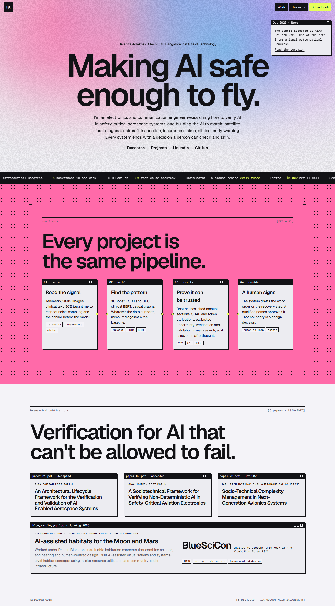
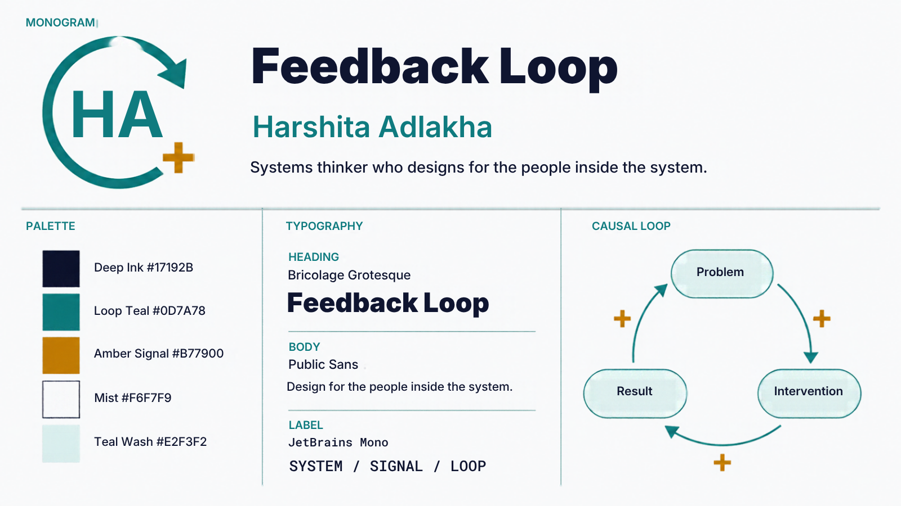
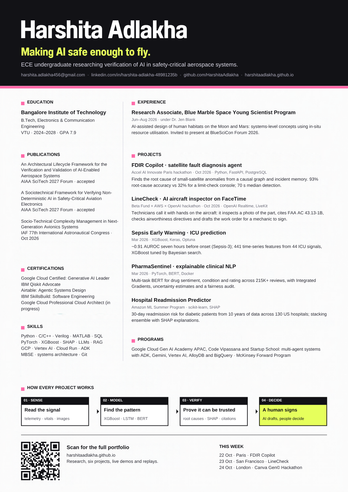
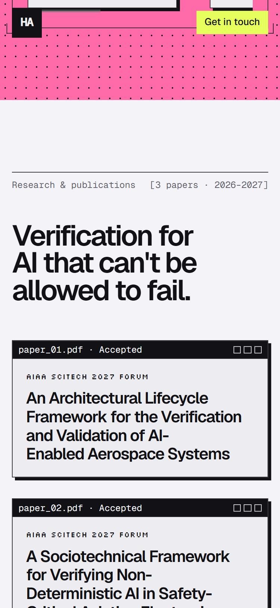
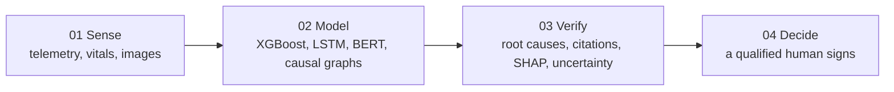

# Feedback Loop

**A personal brand system for an engineer who verifies AI: one brand board, one CV, one live portfolio, all telling the same story.**

> *Making AI safe enough to fly.*

Built by **Harshita Adlakha** for the **Canva Gen© Student Hackathon London**, Saturday 24 October 2026.

**▶ [Visit the live portfolio](https://harshitaadlakha.github.io/)** · **📄 [Download the CV (PDF)](docs/cv/Harshita_Adlakha_CV.pdf)** · **🧭 [Read the strategy brief](docs/strategy-brief.html)**



*The portfolio at harshitaadlakha.github.io: the hero, the four-step pipeline every project follows, and the research section with three papers.*

**Contents:** [The hackathon](#the-hackathon) · [The problem](#the-problem) · [What I built](#what-i-built) · [The idea: three reading depths](#the-idea-three-reading-depths) · [Design system](#design-system) · [How it was built](#how-it-was-built) · [Repository layout](#repository-layout) · [What I learned](#what-i-learned) · [Next steps](#next-steps) · [About me](#about-me) · [Thanks](#thanks) · [References](#references)

---

## The hackathon

| | |
|---|---|
| **Event** | Canva Gen© Student Hackathon London ([Luma page](https://luma.com/zkjafnlt)) |
| **Date and place** | Saturday, 24 October 2026, 10:00–18:00 · London |
| **Presented by** | Bright Creative · hosts Ana Davila and Ninna Bianca Dulalia |
| **Format** | A one-day, no-code design sprint for undergraduates, with work reviewed by the Canva team |
| **Challenges** | Personal Branding (a standout visual identity) · The Future Portfolio (how students show their work) · Creative CVs (turning the résumé into a digital experience) |

I answered all three challenges with one connected system instead of three separate pieces:

| Challenge | My answer | Link |
|---|---|---|
| Personal Branding | Brand board: loop monogram, palette, type, motif | [Canva](https://canva.link/tc6yexkya9jck97) · [image](docs/images/brand-board.png) |
| Creative CVs | One-page visual CV built for a 7-second skim | [Canva](https://canva.link/tfase7bpwdhj8rb) · [PDF](docs/cv/Harshita_Adlakha_CV.pdf) |
| The Future Portfolio | A live site styled like the tools I admire | [harshitaadlakha.github.io](https://harshitaadlakha.github.io/) |

---

## The problem

Recruiters skim, and most creative CVs hide the facts they skim for.

- Ladders' eye-tracking study found recruiters spend about **6 seconds** on a first CV screen, revised to **7.4 seconds** in 2018, and about **80%** of that time goes to six facts: name, current and previous role, dates and education.
- Other measurements differ (a 2023 tracking study put review time at 17–46 seconds), and Ladders sells CV services, so I treat the number as a range, not a law.

The design rule that follows: put those facts where the eye lands first, and let the creative layer add depth without slowing the skim.

My second problem was specific to me. I am an ECE undergraduate whose work spans aerospace research papers, a satellite fault agent, an aircraft inspection agent and three clinical ML models. Listed flat, that reads as scattered. The brand had to show the one thread that runs through all of it.

---

## What I built

### 1. Brand board



A monogram drawn as a feedback loop with a polarity sign, five colours, three typefaces and a reusable three-node loop (problem → intervention → result) that appears on every other piece.

### 2. Visual CV



- **Header band:** name, *Making AI safe enough to fly*, a one-line research summary and every contact. Plain, large and scannable.
- **Left column:** education (GPA 7.9), all three publications, certifications and skills.
- **Right column:** Blue Marble Space research, five projects (each with venue, tools and one result) and programs.
- **Pipeline strip:** the four steps every project follows, styled like the portfolio's windows.
- **Footer:** a working QR code to the live portfolio, drawn as a Canva shape so it stays editable.

### 3. Live portfolio



[harshitaadlakha.github.io](https://harshitaadlakha.github.io/), hosted on GitHub Pages:

- **Hero:** "Making AI safe enough to fly." over an animated grain gradient, with a news window announcing the papers.
- **How I work:** a node canvas of four connected steps (sense → model → verify → a human signs) that every project follows.
- **Research:** the three papers and the Blue Marble Space Young Scientist Program role, each as a desktop window.
- **Projects:** six projects from GitHub, each with one headline number and links to live demos and code.
- **This week:** three hackathons in three days, plus education, certifications and programs.
- **Contact:** email, LinkedIn and GitHub.

---

## The idea: three reading depths

| Depth | Time | Where | What the reader gets |
|---|---|---|---|
| Skim | 7 seconds | CV header band | The six facts recruiters look for |
| Scan | 30 seconds | CV columns and pipeline | Research, projects and one result per project |
| Read | 3 minutes | Portfolio, via the QR code | Papers, live demos, replays and code |

The loop is the visual idea and also the argument. My research is about verifying AI before people rely on it, so every project is drawn as the same pipeline: sense the signal, model it, verify it, and leave the final decision to a qualified person.



---

## Design system

| Token | Value | Use |
|---|---|---|
| Deep Ink | `#17192B` | Text, window title bars |
| Loop Teal | `#0D7A78` | CV accents, brand board |
| Amber Signal | `#B77900` | Polarity signs on the loops |
| Signal Pink | `#FF6AA9` | Portfolio "How I work" band |
| Volt | `#E6FF5C` | One call-to-action colour on the site |
| Mist | `#F4F3F8` | Page background |

**Type:** Geist for headlines, set large and tight; Geist Mono for window chrome and labels; Silkscreen for small pixel labels.

**References:** the portfolio borrows from two interfaces I admire:
- [Figma Weave](https://weave.figma.com/): the node canvas, cards joined by connectors, and a single loud CTA colour.
- [TypeSafe](https://typesafe.ai/): huge tight headlines, grainy gradient skies, retro desktop windows, dot grids and corner crop marks.

I did not copy either. I took one idea from each and built my own content on it.

---

## How it was built

| Time (BST) | Step |
|---|---|
| 13:45 | Strategy brief: challenges, recruiter research, the three-depth idea, a build plan and pitch copy |
| 14:00 | Brand board, CV and a first website drafted in Canva |
| 14:30 | First website rejected: too templated. Studied Figma Weave and TypeSafe and rebuilt the portfolio |
| 15:00 | Pulled real projects and numbers from GitHub and my résumé; repositioned around AI verification research |
| 15:30 | Deployed the site to GitHub Pages, added the URL and QR code to the CV |
| 16:00 | Rebuilt the CV from scratch in Canva: the generated loop layout was mostly empty space, so it became two dense columns, a pipeline strip and a working QR code |

**Tools:** Canva (brand board and CV), the Canva connector inside Claude to draft and edit designs, Claude (Anthropic) for research, copy and the site, GitHub Pages for hosting.

**What was made where:**

| Piece | Made in |
|---|---|
| Brand board | Canva |
| CV | Canva, laid out element by element through the Canva connector |
| Portfolio | Hand-built HTML and CSS (no framework), hosted on GitHub Pages |
| Strategy brief | HTML page |

---

## Repository layout

```
feedback-loop/
├── README.md
├── site/
│   ├── index.html            the portfolio (same file served at harshitaadlakha.github.io)
│   └── qr.png                QR code to the portfolio, for the CV
└── docs/
    ├── strategy-brief.html   idea, research, plan and pitch written before building
    ├── cv/Harshita_Adlakha_CV.pdf
    └── images/               brand board, CV and portfolio screenshots
```

The portfolio is one self-contained HTML file. To run it locally, open `site/index.html` in a browser. The page source lives in [HarshitaAdlakha/harshitaadlakha.github.io](https://github.com/HarshitaAdlakha/harshitaadlakha.github.io).

---

## What I learned

- **Facts first.** The most creative choice on the CV is how plain the top band is.
- **One story beats many projects.** Repositioning around verification ("making AI safe enough to fly") made six unrelated-looking projects read as one body of work.
- **Generated templates weren't enough.** The first website draft was generic. Studying two real interfaces and taking one idea from each produced something with a point of view.
- **Every number needs a source.** Each metric on the CV and site comes from my résumé or a project README, and the sepsis result notes that the public demo runs on synthetic data.

## Next steps

- Add paper links when the AIAA SciTech 2027 proceedings are published
- Resize the brand board into a LinkedIn banner
- Add a short case-study page for each project

---

## About me

**Harshita Adlakha** · B.Tech, Electronics and Communication Engineering, Bangalore Institute of Technology (VTU), 2024–2028

Researching systems engineering and verification frameworks for AI in safety-critical aerospace systems.

[Portfolio](https://harshitaadlakha.github.io/) · [LinkedIn](https://www.linkedin.com/in/harshita-adlakha-48981235b) · [GitHub](https://github.com/HarshitaAdlakha)

## Thanks

Thank you to **Bright Creative** and hosts **Ana Davila** and **Ninna Bianca Dulalia** for running the Canva Gen© Student Hackathon, to the **Canva** team for the tools and for reviewing our work, and to every student who built alongside me. Thanks also to **Paras Adlakha**, my teammate on LineCheck and FDIR Copilot earlier this week.

## References

- Ladders, *Eye-Tracking Study* (2012; updated 2018), via [WEF](https://weforum.org/stories/2014/11/what-recruiters-look-your-cv-resume) and [Barclay Simpson](https://www.barclaysimpson.com/how-long-do-recruiters-spend-looking-at-cv/)
- [Figma Weave](https://www.figma.com/solutions/figma-ai-tool-weave/) and [TypeSafe](https://typesafe.ai/), design references
- Projects referenced: [FDIR Copilot](https://github.com/HarshitaAdlakha/fdir-copilot) · [LineCheck](https://github.com/HarshitaAdlakha/linecheck) · [PharmaSentinel](https://github.com/HarshitaAdlakha/pharmasentinel) · [Sepsis Early Warning](https://github.com/HarshitaAdlakha/sepsis-early-warning) · [Hospital Readmission Predictor](https://github.com/HarshitaAdlakha/hospital-readmission-predictor) · [Off-World Robot Architect](https://github.com/HarshitaAdlakha/Off-World-Robot-Architect-Lunar-Martian-Mechanical-Assistant-Simulator)
